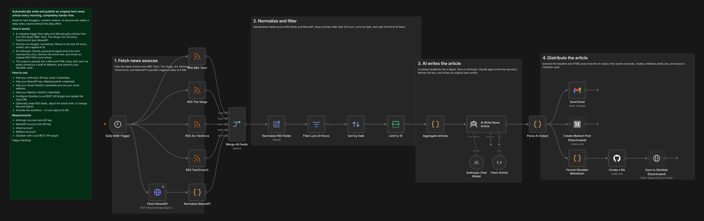
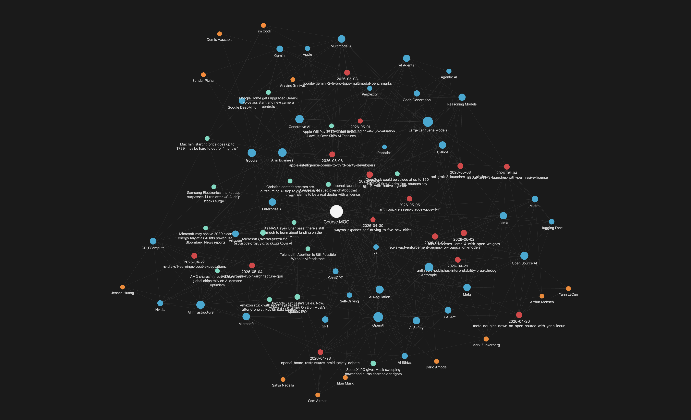

# Demo Walkthrough — n8n + Obsidian AI News Pipeline

How this project was presented in the **AI in Business** course (May 2026), and the design
decisions behind it. For setup instructions see the [README](README.md).

---

## 1. The Pitch

> "Every morning at 8 AM, an n8n workflow scans tech RSS feeds and NewsAPI, picks the most
> important story of the past 24 hours, has Claude write a structured analysis of it, and
> commits the result straight to a GitHub repo that my Obsidian vault syncs from. The result:
> a knowledge graph of AI news that grows every day — without me writing a word."

---

## 2. Architecture

```
┌──────────────┐     ┌──────────────────────────────┐     ┌─────────────────┐
│  Daily 8 AM  │ ──▶ │ Fetch RSS + NewsAPI          │ ──▶ │ Normalize +     │
│  trigger     │     │ (BBC Tech, Verge, Ars,       │     │ filter (24h,    │
│              │     │  TechCrunch, NewsAPI)        │     │  top 15)        │
└──────────────┘     └──────────────────────────────┘     └────────┬────────┘
                                                                    │
                            ┌───────────────────────────────────────┘
                            ▼
                   ┌────────────────────┐     ┌────────────────────────┐
                   │ Claude AI Agent    │ ──▶ │ Parse AI Output (JS)   │
                   │ + Fetch Article    │     │ → title, slug, content │
                   │   tool             │     └─────────┬──────────────┘
                   └────────────────────┘               │
                            ┌───────────────────────────┼─────────────────────┐
                            ▼                           ▼                     ▼
                   ┌────────────────┐         ┌──────────────────┐    ┌──────────────┐
                   │ Send Email     │         │ Medium draft     │    │ Commit to    │
                   │ (Gmail)        │         │ (disabled)       │    │ GitHub repo  │
                   └────────────────┘         └──────────────────┘    └──────┬───────┘
                                                                              ▼
                                                                  ┌────────────────────┐
                                                                  │ Obsidian Git pull  │
                                                                  │ → Graph view       │
                                                                  └──────────┬─────────┘
                                                                              ▼
                                                                  ┌────────────────────┐
                                                                  │ Vault Chat         │
                                                                  │ (Streamlit+Claude) │
                                                                  └────────────────────┘
```



---

## 3. Walkthrough

1. **The workflow** — four sections in n8n: *fetch sources* (4 RSS feeds + NewsAPI in
   parallel), *normalize and filter* (common fields, last 24 hours, top 15), *AI writes the
   article* (a Claude agent with a `Fetch Article` tool reads the most important story in full),
   and *distribute* (email, Medium draft, GitHub commit).
2. **The commit** — n8n's GitHub node writes `10-News/YYYY-MM-DD <slug>.md` straight to the repo.
3. **The vault** — Obsidian Git pulls the new note; it already links to concept and people
   hubs via `[[wikilinks]]`.
4. **The graph** (Cmd-G) — clusters emerge around labs, hardware, regulation and open source.
   `Course MOC` sits in the middle as the single entry point.
5. **Web clipping** — articles saved with Obsidian Web Clipper join the same graph
   (kept as short excerpts that link to the original).
6. **Vault Chat** — ask a question in plain English; Claude answers from the vault and cites
   the notes it used.



---

## 4. Design Decisions

**Why Obsidian instead of Notion or Confluence?**
Plain markdown files, local-first, free graph view, no vendor lock-in, Git-friendly. The graph
view makes the knowledge structure tangible.

**Why GitHub as the middleware?**
n8n Cloud blocks calls to localhost and private IPs (SSRF protection), so it can't write to a
local folder. GitHub solves auth, persistence, sync and version history in one step. The local
webhook server (`webhook-server.js`) is kept for self-hosted n8n setups.

**How does Vault Chat find answers, and is it RAG?**
Yes, in its simplest form. RAG (retrieval-augmented generation) has three steps: *retrieve*
the relevant documents, *augment* the prompt with them, and *generate* an answer grounded in
them. Vault Chat does all three, but its retrieval step is "take everything": it reads the
81 notes in `10-News/`, `20-Concepts/`, `25-People/` and `00-Inbox/` (about 27,000 words, or
roughly 36,000 tokens) and puts them all in the prompt. Claude then does the real retrieval
itself, picking the notes that answer the question and citing them as sources.

At this size, that is the better design:

- **Nothing gets missed.** A search step can skip the one note that matters; here Claude sees
  every note, so it can also answer broad questions like "what were the main themes this week?"
- **It stays cheap.** Prompt caching stores the vault on Anthropic's side, so follow-up
  questions read it at about a tenth of the normal input price.
- **There is nothing to maintain.** No embeddings, no vector database, no re-indexing when a
  new note arrives — the next question simply includes it.

**What happens at 10,000 stories?**
This approach stops working. A news note averages ~800 words (~1,100 tokens), so 10,000
stories is about 11 million tokens — far more than any model's context window, and even
before that limit, every question would get slower, more expensive, and less accurate as the
relevant notes are buried in the noise. At one note a day, the vault would outgrow a
200,000-token window in about five months.

At that scale Vault Chat would need a real retrieval step in front of Claude:

1. **Index** — split each note into its sections (TL;DR, Summary, Why It Matters), create an
   embedding for each one, and store them in a vector index (for example, pgvector or Chroma)
   next to a keyword index. New notes are indexed as the pipeline commits them.
2. **Search** — for each question, run keyword and semantic search together, and use the
   frontmatter (date, source, tags) to filter, e.g. "only May 2026".
3. **Expand with the graph** — the `[[wikilinks]]` are already a knowledge graph, so the
   matching notes can pull in their linked concept and people hubs for context.
4. **Rerank and answer** — keep the best ~20 notes, send only those to Claude, and keep the
   source citations as they work today.

The hub notes (`20-Concepts/`, `25-People/`) would stay fully in context, since they are
short and give Claude the map of the whole vault.

**What did it cost to run?**
- n8n Cloud Starter: ~€20/month (or self-host for free)
- Anthropic API: ~$0.05 per daily run
- GitHub: free

---

## 5. What I'd Do Next

1. **Split each daily digest into per-story notes** so the graph fills out faster.
2. **Add an AI-relevance filter** so non-AI tech news doesn't dilute the corpus.
3. **Weekly digest** — aggregate seven daily notes into one long-form article.
4. **Replace n8n Cloud with a scheduled GitHub Action** so the pipeline runs for free.
5. **Add a retrieval step to Vault Chat** once the vault grows past a few hundred notes (see
   *What happens at 10,000 stories?* above).
