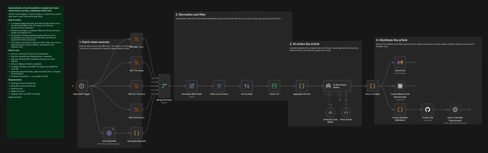
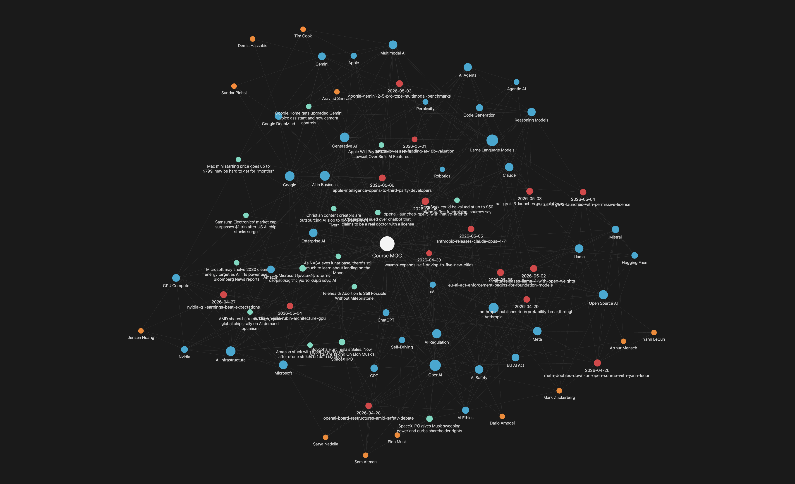
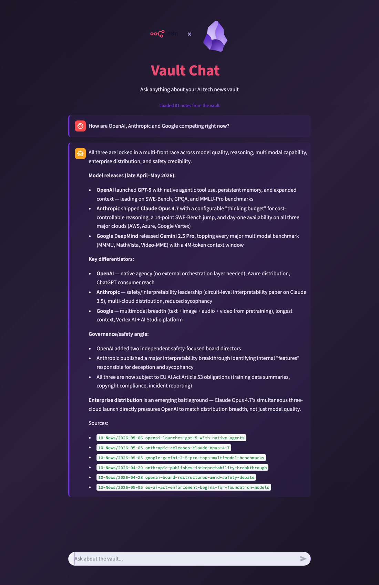

# AI News Knowledge Graph — n8n + Claude + Obsidian

An automated pipeline that turned daily tech news into a linked Obsidian knowledge graph,
built for an **AI in Business** course. An n8n workflow fetched the news every morning, a
Claude agent wrote a structured analysis, and the note was committed straight to this repo.
A small Streamlit app, **Vault Chat**, lets you ask questions about the vault.

> **Status:** the pipeline ran in May 2026 on n8n Cloud and is no longer scheduled. This repo
> is a snapshot of the vault plus everything needed to run it again (see
> [Run it yourself](#run-it-yourself)).



## The Knowledge Graph



| Color | Folder | What it holds |
|---|---|---|
| ⚪ White | `00-Inbox/` | `Course MOC` — the hub note and entry point |
| 🔴 Red | `10-News/` | Daily news notes: TL;DR, key concepts, summary, why it matters |
| 🔵 Blue | `20-Concepts/` | Companies, models and themes (OpenAI, LLMs, EU AI Act, …) |
| 🟠 Orange | `25-People/` | CEOs and researchers |
| 🟢 Green | `30-Articles/` | Web clippings, linked to the concepts they mention |

The 15 notes in `10-News/` whose source is `example.com` are hand-written examples that set
the target format; the other 17 were generated by the pipeline between May 6 and May 9, 2026.

## Vault Chat

Ask the vault anything. The app loads every note into Claude's context (with prompt caching)
and answers with the notes it used as sources. It's the simplest form of RAG — see
[DEMO.md](DEMO.md#4-design-decisions) for why, and what would change at 10,000 stories.



## How the Pipeline Works

1. **Daily 8 AM trigger** in n8n.
2. Fetches news from RSS (BBC Tech, The Verge, Ars Technica, TechCrunch) and NewsAPI, keeps
   the last 24 hours, and takes the top 15.
3. A Claude **AI Agent** picks the most important story, reads it in full with a
   `Fetch Article` tool, and writes an original analysis.
4. The result is emailed (Gmail) and formatted as Obsidian markdown.
5. The **GitHub node** commits it to `10-News/YYYY-MM-DD <slug>.md` in this repo.
6. The Obsidian Git plugin pulls, and the new note appears in the graph.

More detail and design decisions: [DEMO.md](DEMO.md).

## Run It Yourself

**Explore the vault** — clone the repo and open the folder as a vault in Obsidian, then press
Cmd-G for the graph view.

**Vault Chat**

```bash
python3 -m venv .venv && source .venv/bin/activate
pip install -r requirements.txt
cp .env.example .env   # then set ANTHROPIC_API_KEY
streamlit run vault_chat.py
```

**The n8n workflow** — n8n's self-hosted Community Edition is free:

```bash
docker run -it --rm -p 5678:5678 -v n8n_data:/home/node/.n8n docker.n8n.io/n8nio/n8n
```

Open `localhost:5678`, import `99-Archive/n8n-workflows/AI-Powered Tech news Agent.json`, then
add your own credentials (Anthropic, NewsAPI header auth, Gmail OAuth2, GitHub OAuth2) and
change the Gmail `sendTo` address and the GitHub node's owner/repository to your own. The
Medium and "Save to Obsidian" nodes are disabled alternatives.

**Optional: local webhook server** — `webhook-server.js` is an alternative to the GitHub step
for self-hosted n8n: n8n POSTs JSON to `localhost:5679/news` or `/article` and the server
writes the markdown files. Run it with `sh start.sh` after setting `VAULT_PATH` in `.env`.

## Repository Layout

```
00-Inbox/            Course MOC (hub note)
10-News/             daily news notes
20-Concepts/         concept hubs
25-People/           people hubs
30-Articles/         web clippings (excerpts)
99-Archive/n8n-workflows/   exported n8n workflow
assets/              screenshots
vault_chat.py        Streamlit chat app
webhook-server.js    optional local webhook
DEMO.md              walkthrough and design decisions
```

## A Note on the Web Clippings

The notes in `30-Articles/` were saved with Obsidian Web Clipper during the course. They're
kept here only as short excerpts with a link to the original. All rights belong to the
original publishers (Reuters, WIRED, Ars Technica, The Verge, techblog.gr).

